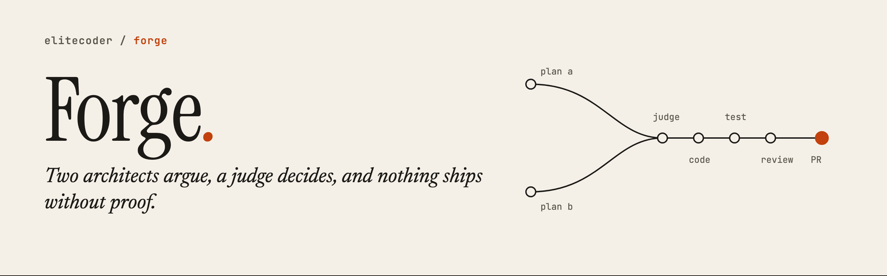
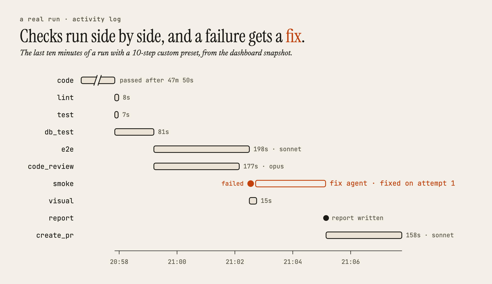
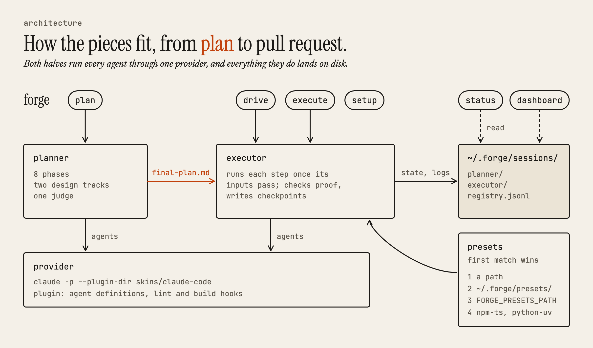
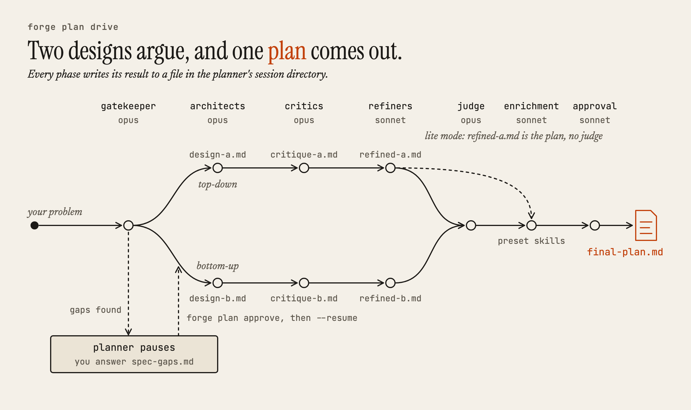
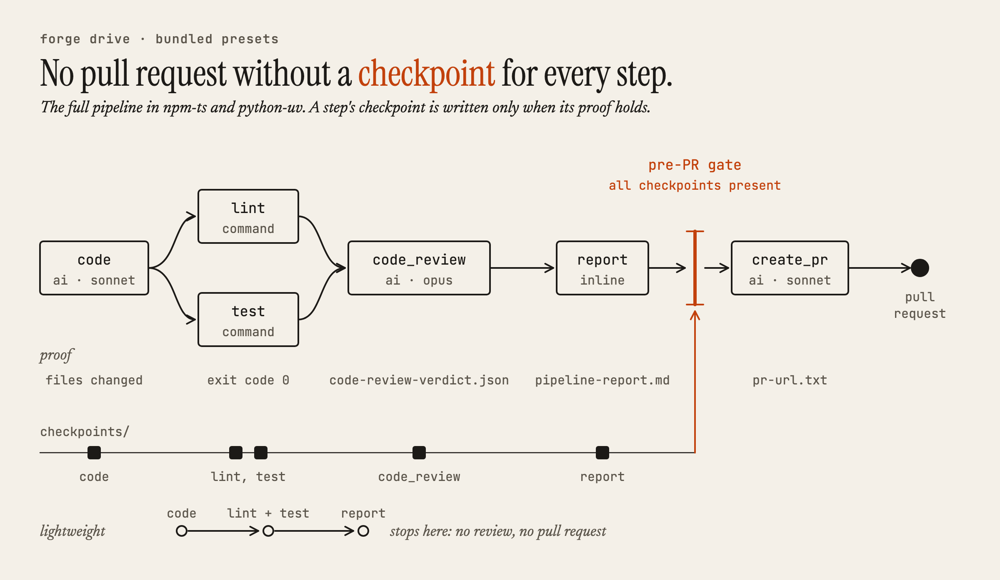
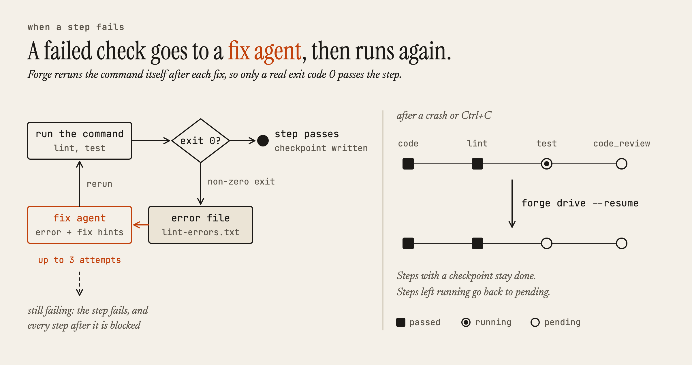
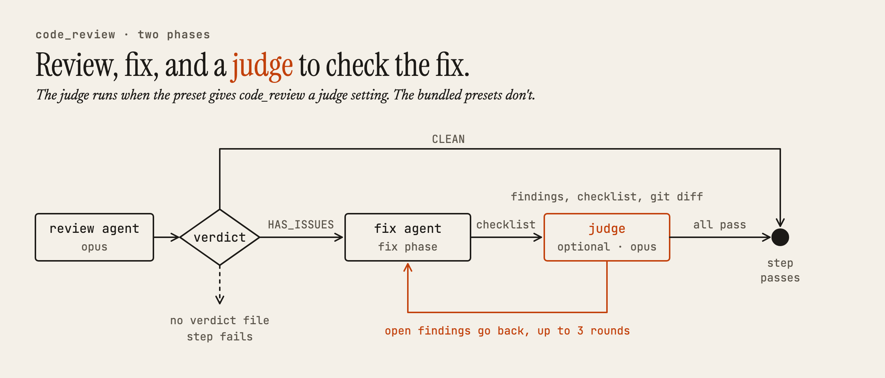
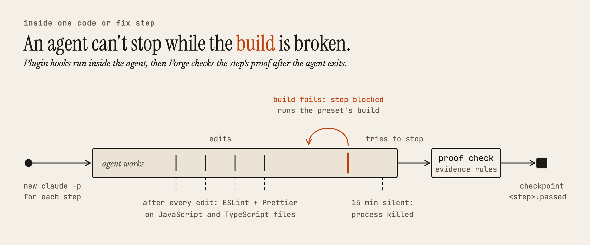

<picture>
  <source media="(prefers-color-scheme: dark)" srcset="docs/images/banner-dark.png">
  
</picture>

AI coding agents are fast at writing code and as fast at calling it done. Forge slows down the two places where that hurts: two AI architects argue over the design before any code exists, and a fixed pipeline won't pass a step until it leaves proof on disk.

Forge is a Python command-line tool that drives [Claude Code](https://docs.anthropic.com/en/docs/claude-code). It's for developers who already hand features to an agent and want a plan worth reading and a pull request that has actually been through the checks.

## What a run looks like

You give Forge a problem in plain words, and it plans:

```bash
forge plan drive --problem "Add a 404 page that links back to the dashboard"
```

The planner prints the path to `final-plan.md` and its session directory, which also holds both designs, the critiques, and the gatekeeper's notes on gaps in your request. Then you hand the plan to the pipeline:

```bash
forge drive --plan-dir ~/.forge/sessions/planner/<session> --preset npm-ts
```

<picture>
  <source media="(prefers-color-scheme: dark)" srcset="docs/images/run-timeline-dark.png">
  
</picture>

This real run used a 10-step custom preset. When the smoke test failed, Forge handed the error to a fresh fix agent instead of stopping, and the pull request came last.

<details>
<summary>The activity log behind this timeline</summary>

```text
[20:57:51] code                 ✓ passed  2870s
[20:57:51] lint                 ⣾ running
[20:57:51] test                 ⣾ running
[20:57:51] db_test              ⣾ running
[20:57:58] test                 ✓ passed  7s
[20:57:59] lint                 ✓ passed  8s
[20:59:12] db_test              ✓ passed  81s
[20:59:12] e2e                  ⣾ agent (sonnet)
[20:59:12] code_review          ⣾ agent (opus)
[21:02:09] code_review          ✓ passed  177s
[21:02:30] e2e                  ✓ passed  198s
[21:02:30] smoke                ⣾ running
[21:02:30] visual               ⣾ running
[21:02:31] smoke                ✗ failed → fix agent (attempt 1/3)
[21:02:31] smoke                ⣾ fix agent (sonnet)
[21:02:45] visual               ✓ passed  15s
[21:05:08] smoke                ✓ fixed (attempt 1)  159s
[21:05:09] report               ✓ report generated
[21:05:09] create_pr            ⣾ agent (sonnet)
[21:07:46] create_pr            ✓ passed  158s
```

</details>

## Quick start

### Before you begin

You need:

- Python 3.12 or later, and git.
- The Claude Code CLI, installed as `claude` on your `PATH` and signed in. Forge runs every agent through it.
- Node.js and npm. `forge drive` won't start without ESLint and Prettier on your `PATH`, even for a Python project, and `forge setup` installs both globally.
- The GitHub CLI, `gh`, if you use the bundled presets' `create_pr` step.

Forge's agents run as `claude -p --dangerously-skip-permissions`, so they edit files and run commands without asking. Give each change its own git worktree. `forge drive` refuses to run outside one unless you pass `--no-worktree`.

### Install

Forge isn't on PyPI. Clone it and install it in editable mode:

```bash
git clone https://github.com/elitecoder/forge.git
cd forge
pip install -e .
export FORGE_PLUGIN_DIR="$PWD/skins/claude-code"
forge setup
```

`FORGE_PLUGIN_DIR` points Forge at its Claude Code plugin, which holds the agent definitions and the lint and build hooks. Add the `export` line to your shell profile so it's set in every session.

You can also install the command with `pip install git+https://github.com/elitecoder/forge.git`. The plugin isn't part of that install, so you still need a clone for `FORGE_PLUGIN_DIR`.

### Plan and build a change

1.  Create a worktree for the change:

    ```bash
    cd ~/code/my-app
    git worktree add ../my-app-404 -b add-404-page
    cd ../my-app-404
    ```

2.  Plan it:

    ```bash
    forge plan drive --problem "Add a 404 page that links back to the dashboard"
    ```

    If the gatekeeper finds gaps in your request, the planner stops and writes them to `spec-gaps.md` in the session directory. Answer them in a markdown file, then continue:

    ```bash
    forge plan approve --answers answers.md
    forge plan drive --resume --session <planner-session-dir>
    ```

    To let the planner go ahead on its own assumptions instead, pass `--auto-approve`.

3.  Build it. Pass the session directory the planner printed, and the preset for your stack (`npm-ts` or `python-uv`):

    ```bash
    forge drive --plan-dir <planner-session-dir> --preset npm-ts
    ```

    If the run stops partway, pick it up where it left off:

    ```bash
    forge drive --resume
    ```

You can also skip the planner and pass any markdown plan with `--plan path/to/plan.md`.

### Try it without spending tokens

`--dry-run` checks your plan and preset and prints what would run, without calling a model:

```console
$ forge drive --plan-dir plans/404 --preset npm-ts --dry-run

Pipeline: full | Preset: npm-ts

Plan: final-plan.md (6 words)

Plan file: /path/to/plans/404/final-plan.md
Would run: forge execute init full --preset npm-ts --plan /path/to/plans/404/final-plan.md
Packages: []
```

When you're ready for a real run but want it cheap, `--fast` runs every AI step on Haiku, and `forge plan drive --lite` uses one architect, one critic, and one refiner, with no judge.

### Keep an eye on it

- `forge status --active` lists running planner and pipeline sessions as JSON.
- `forge dashboard` opens a local web view of every session at `http://localhost:8765`.

## How it works

<picture>
  <source media="(prefers-color-scheme: dark)" srcset="docs/images/architecture-dark.png">
  
</picture>

### Planning: argue first

<picture>
  <source media="(prefers-color-scheme: dark)" srcset="docs/images/planner-dark.png">
  
</picture>

The gatekeeper also decides between the full planner and the lite one. To skip the pause for gaps and let the planner go ahead on its own assumptions, pass `--auto-approve`.

### Building: prove each step

<picture>
  <source media="(prefers-color-scheme: dark)" srcset="docs/images/pipeline-dark.png">
  
</picture>

Each step starts a new `claude` process with a focused prompt, so no agent inherits a long conversation from the step before. Progress lives in a JSON state file plus one checkpoint per step, and the pre-PR gate won't accept a manually skipped `test` step.

<picture>
  <source media="(prefers-color-scheme: dark)" srcset="docs/images/recovery-dark.png">
  
</picture>

If a step still fails after three attempts, the steps that depend on it are blocked and the run stops.

<picture>
  <source media="(prefers-color-scheme: dark)" srcset="docs/images/review-dark.png">
  
</picture>

<picture>
  <source media="(prefers-color-scheme: dark)" srcset="docs/images/guards-dark.png">
  
</picture>

After the code agent exits, Forge also runs the preset's build command itself, if the preset has one, and checks the exit code.

## Presets

A preset tells Forge how your stack builds, lints, and tests, and which steps make up a pipeline. Two ship with Forge:

| Preset | Lint | Test |
|---|---|---|
| `npm-ts` | `npx eslint --fix .` | `npx vitest run` |
| `python-uv` | `uv run ruff check --fix .` and `uv run ruff format .` | `uv run pytest` |

Each has a `full` pipeline, which ends in a pull request, and a `lightweight` one, which stops after lint and tests.

To fit Forge to your own project, write a preset and pass its path:

```
my-preset/
├── manifest.json    # Pipeline definition, steps, evidence rules
└── skills/          # Step-specific prompt templates
    ├── code-review.md
    └── create-pr.md
```

```bash
forge drive --plan plan.md --preset ./my-preset
```

Forge also looks for presets by name in `~/.forge/presets/` and in the directories listed in `FORGE_PRESETS_PATH`.

## Reference

The [full reference](docs/reference.md) covers every command and flag, the `manifest.json` fields, evidence rules, planner phase models and timeouts, environment variables, the session layout on disk, and a map of the source.

Here are the commands you'll use most:

| Command | What it does |
|---|---|
| `forge plan drive --problem "..."` | Runs the planner end to end. Add `--lite`, `--auto-approve`, `--preset`, or `--resume`. |
| `forge plan approve --answers FILE` | Unblocks a planner paused on gaps in the spec. |
| `forge drive --plan FILE --preset NAME` | Runs a plan through a pipeline. Add `--pipeline`, `--fast`, `--dry-run`, or `--no-worktree`. |
| `forge drive --resume [--skip STEP ...]` | Continues an interrupted pipeline. |
| `forge execute <subcommand>` | Controls a pipeline one step at a time. |
| `forge status [--active]` | Lists sessions as JSON. |
| `forge setup [--preset NAME]` | Installs ESLint and Prettier, plus any setup the preset declares. |
| `forge dashboard [--port N]` | Opens the local dashboard. Default port 8765. |

### Providers

Forge talks to agents through a small `Provider` protocol in `src/forge/providers/protocol.py`:

```python
class Provider(Protocol):
    def run_agent(self, prompt, model, max_turns, cwd, ...) -> AgentResult: ...
    def run_judge(self, prompt, model, ...) -> str: ...
```

This release ships one provider, for Claude Code. Model tiers in `src/forge/providers/models.py` keep vendor model names out of the rest of the code:

| Tier | Purpose | Claude | Codex |
|------|---------|--------|-------|
| `reasoning` | Planning, judging | Opus | o3 |
| `balanced` | Implementation | Sonnet | GPT-4.1 |
| `fast` | Quick fixes | Haiku | GPT-4.1-mini |

## Development

```bash
uv sync --extra dev
uv run pytest
uv run ruff check src/forge/dashboard/ tests/dashboard/
```

The suite has over 1,100 tests. CI runs the lint check and the dashboard tests on every pull request. [`docs/test-quality-rubric.md`](docs/test-quality-rubric.md) is the rubric used to grade test quality per module, and [`CHANGELOG.rst`](CHANGELOG.rst) records every change.

## License

Apache 2.0. See [LICENSE](LICENSE).
