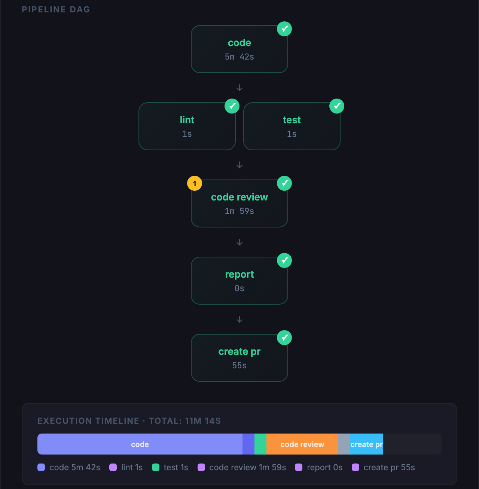
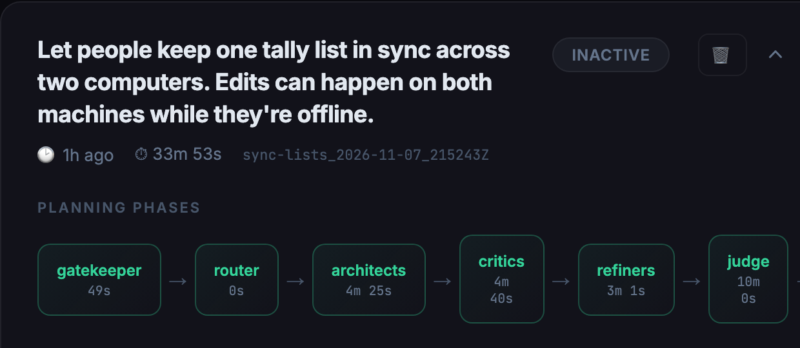
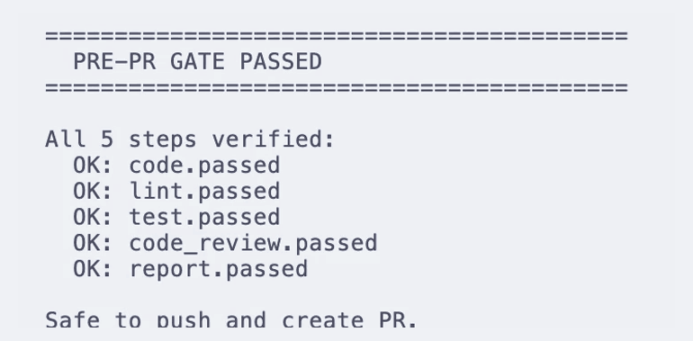
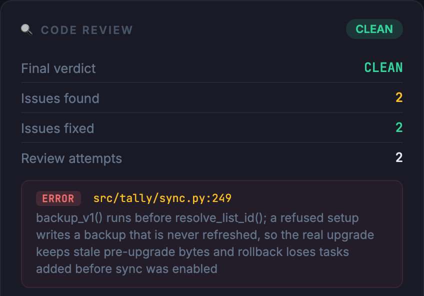

# Forge

**Forge plans a change with two competing AI architects and a judge, then builds it through a pipeline that won't pass a step without proof.**

You describe a change in one sentence. Forge runs Claude Code agents to argue over the design, then codes, lints, tests, reviews, and opens the pull request, one checked step at a time.

<p align="center"></p>

Every image here comes from one real run on a small Python to-do app. Its last step pushed to a local repository instead of opening a GitHub pull request.

## Features

### Two architects, critics, and a judge

Two architects design the change top-down and bottom-up, a critic attacks each design, and a judge merges the best parts into `final-plan.md`. You get a plan you can argue with before any code exists.



### No pull request without proof

Each step writes a checkpoint only after Forge checks its evidence, and a gate refuses to push until every step has one. A step can't quietly claim it passed.



### Review findings go back for a fix

An Opus reviewer reports each issue with a file and line, and a fresh agent fixes it before the step can pass. In this run it caught a backup written in the wrong order.



### Also in the box

- When lint or tests fail, a fix agent gets the error and Forge reruns the command, up to three attempts.
- `forge dashboard` shows every planner and pipeline session in your browser.
- `--resume` picks up an interrupted planner or pipeline where it stopped.
- `--auto-approve` lets the planner go ahead when the gatekeeper finds gaps in your request. `--lite` uses one architect and no judge.
- `--dry-run` shows what would run without calling a model, and `--fast` runs every AI step on Haiku.
- Hooks run ESLint and Prettier after each JavaScript or TypeScript edit, and a stop hook blocks a code agent while the build fails.

## Quick start

### Before you begin

You need:

- Python 3.12 or later, and git.
- The Claude Code CLI, installed as `claude` on your `PATH` and signed in. Forge runs every agent through it, and Claude Code is the only agent tool it supports.
- Node.js and npm. `forge drive` won't start without ESLint and Prettier on your `PATH`, even for a Python project, and `forge setup` installs both globally.
- The GitHub CLI, `gh`, if you use the bundled presets' `create_pr` step.

Forge's agents run as `claude -p --dangerously-skip-permissions`, so they edit files and run commands without asking. Give each change its own git worktree. `forge drive` refuses to run outside one unless you pass `--no-worktree`.

### Install

Forge isn't on PyPI. Clone it and install it in editable mode:

```bash
git clone https://github.com/elitecoder/forge.git
cd forge
pip install -e .
export FORGE_PLUGIN_DIR="$PWD/skins/claude-code"
forge setup
```

`FORGE_PLUGIN_DIR` points Forge at its Claude Code plugin, which holds the agent definitions and the lint and build hooks. Add the `export` line to your shell profile so it's set in every session.

You can also install the command with `pip install git+https://github.com/elitecoder/forge.git`. The plugin isn't part of that install, so you still need a clone for `FORGE_PLUGIN_DIR`.

### Plan and build a change

1.  Create a worktree for the change:

    ```bash
    cd ~/code/my-app
    git worktree add ../my-app-404 -b add-404-page
    cd ../my-app-404
    ```

2.  Plan it:

    ```bash
    forge plan drive --problem "Add a 404 page that links back to the dashboard"
    ```

    If the gatekeeper finds gaps in your request, the planner stops and writes them to `spec-gaps.md` in the session directory. Answer them in a markdown file, then continue:

    ```bash
    forge plan approve --answers answers.md
    forge plan drive --resume --session <planner-session-dir>
    ```

3.  Build it. Pass the session directory the planner printed, and the preset for your stack (`npm-ts` or `python-uv`):

    ```bash
    forge drive --plan-dir <planner-session-dir> --preset npm-ts
    ```

    If the run stops partway, pick it up where it left off:

    ```bash
    forge drive --resume
    ```

You can also skip the planner and pass any markdown plan with `--plan path/to/plan.md`.

## Presets

A preset tells Forge how your stack builds, lints, and tests, and which steps make up a pipeline. Two ship with Forge:

| Preset | Lint | Test |
|---|---|---|
| `npm-ts` | `npx eslint --fix .` | `npx vitest run` |
| `python-uv` | `uv run ruff check --fix .` and `uv run ruff format .` | `uv run pytest` |

Each has a `full` pipeline (code, then lint and test in parallel, then code review, report, and a pull request) and a `lightweight` one, which stops after lint and tests.

To fit Forge to your own project, write a preset and pass its path:

```
my-preset/
├── manifest.json    # Pipeline definition, steps, evidence rules
└── skills/          # Step-specific prompt templates
    ├── code-review.md
    └── create-pr.md
```

```bash
forge drive --plan plan.md --preset ./my-preset
```

Forge also looks for presets by name in `~/.forge/presets/` and in the directories listed in `FORGE_PRESETS_PATH`.

## Reference

The [full reference](docs/reference.md) covers every command and flag, the `manifest.json` fields, evidence rules, planner phase models and timeouts, environment variables, the session layout on disk, and a map of the source.

| Command | What it does |
|---|---|
| `forge plan drive --problem "..."` | Runs the planner end to end. Add `--lite`, `--auto-approve`, `--preset`, or `--resume`. |
| `forge plan approve --answers FILE` | Unblocks a planner paused on gaps in the spec. |
| `forge drive --plan FILE --preset NAME` | Runs a plan through a pipeline. Add `--pipeline`, `--fast`, `--dry-run`, or `--no-worktree`. |
| `forge drive --resume [--skip STEP ...]` | Continues an interrupted pipeline. |
| `forge execute <subcommand>` | Controls a pipeline one step at a time. |
| `forge status [--active]` | Lists sessions as JSON. |
| `forge setup [--preset NAME]` | Installs ESLint and Prettier, plus any setup the preset declares. |
| `forge dashboard [--port N]` | Opens the local dashboard. Default port 8765. |

Forge talks to agents through a small `Provider` protocol in `src/forge/providers/protocol.py`. This release ships one provider, for Claude Code.

## Development

```bash
uv sync --extra dev
uv run pytest
uv run ruff check src/forge/dashboard/ tests/dashboard/
```

The suite has over 1,100 tests. CI runs the lint check and the dashboard tests on every pull request. [`docs/test-quality-rubric.md`](docs/test-quality-rubric.md) is the rubric used to grade test quality per module, and [`CHANGELOG.rst`](CHANGELOG.rst) records every change.

## License

Apache 2.0. See [LICENSE](LICENSE).
